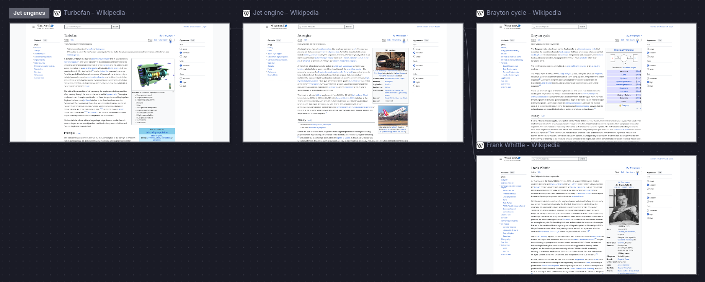
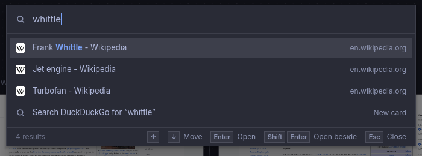
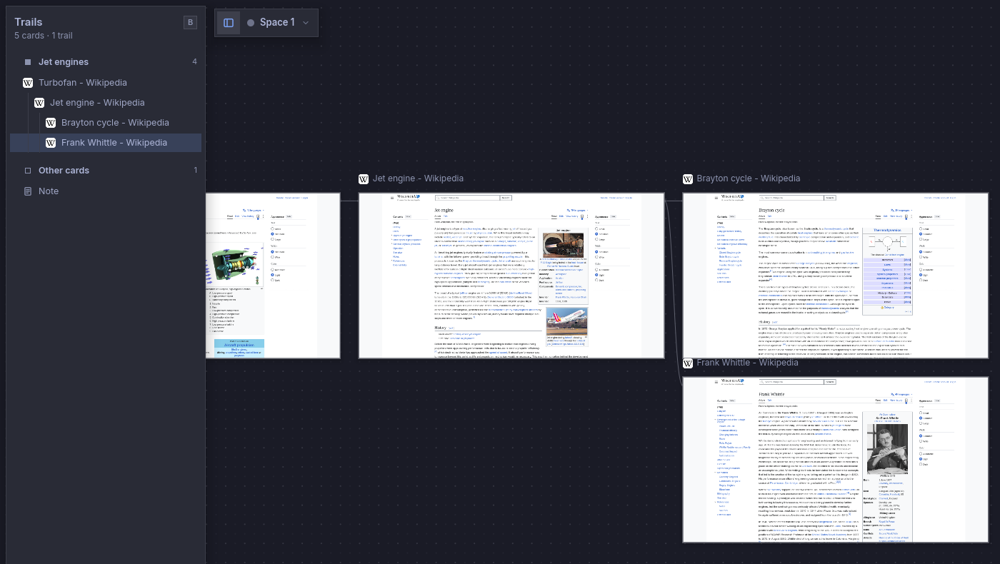

<div align="center">


# Trailboard

### Browse on a board, not in tabs.

Pages are live cards on an infinite canvas. Click a link and it opens **beside** the page it came from,<br>
so every rabbit hole leaves a trail you can see, follow back, and pick up tomorrow.


[Install](#install) · [How it works](#how-it-works) · [Keys](#keys-you-need) · [Guide](docs/GUIDE.md)

<br>



<sub>One trail, four pages: Turbofan → Jet engine → Brayton cycle, with a branch to Frank Whittle.</sub>

</div>

<br>

## How it works

<table>
<tr>
<td width="33%" valign="top">

**1 · Open a page**

It lands on the board as a card: a real, live web page you can scroll, type in and click.

</td>
<td width="33%" valign="top">

**2 · Follow a link**

The new page opens next to its source, joined by a line. Your path stays on screen.

</td>
<td width="33%" valign="top">

**3 · Find your way back**

Zoom out to see the whole trail, or jump to any card from the palette or sidebar.

</td>
</tr>
</table>

## What's on the board

| | |
|---|---|
| **Trails** | Every link remembers where it came from. Name a trail, colour it, fold it into a stack. |
| **Live cards** | Each card is a full Chromium page. Pan, zoom, drag, resize. Off-screen cards sleep to save memory. |
| **Keyboard first** | `h j k l` between cards, `f` to follow links, `Ctrl+K` for everything else. |
| **Tidy & Fold** | One key lays a messy board out without overlaps; another folds a trail into a stack. |
| **Notes** | Markdown and sticky notes live beside your pages. Quote a selection into a note, save the board as Markdown. |
| **Spaces** | A separate board per topic, each with its own tint. Private spaces keep no history. |
| **Private by default** | Ads, trackers and cookie banners blocked with uBlock Origin's lists. Everything stays on your disk. |
| **Fits your desktop** | Follows your Omarchy theme and Hyprland's rounding live. |

<table>
<tr>
<td width="50%" valign="top">

**Find anything** · `Ctrl+K`



Cards, closed cards, history (by any word on the page), commands, other spaces.

</td>
<td width="50%" valign="top">

**See every trail** · `Ctrl+B`



Each trail as a tree. Walk it with `j`/`k`, pin it, rename it.

</td>
</tr>
</table>

## Install

**Arch / Omarchy**: builds from source, fetches its own Chromium engine (with H.264, AAC and HEVC video, see below), adds a launcher entry.

```sh
git clone https://github.com/AyushKr2003/trailboard && cd trailboard/packaging/arch
makepkg -si                         # TRAILBOARD_CODECS=0 makepkg -si for the standard engine
```

**Any other distro**: build a portable archive (~150 MB), unpack it anywhere, run `./trailboard`.

```sh
./scripts/install-cef.sh && ./scripts/bundle.sh
```

<details>
<summary><b>Run from source</b> (for development)</summary>

Needs Rust, CMake, Ninja, curl and a Vulkan driver.

```sh
./scripts/install-cef.sh --codecs       # Chromium engine (CEF) into ~/.local/share/cef
cargo run --release -p trailboard -- https://en.wikipedia.org/wiki/Turbofan
```

`install-cef.sh` also writes the local `.cargo/config.toml` (CEF's path and
rpath) if you don't have one. Run it again with `--standard` or `--codecs`
to switch engines; `--help` lists the options. `trailboard --version` says
which one is installed (`standard build` or `media build`).

`cargo test` and `cargo clippy` must pass before a change goes in.

</details>

<details>
<summary><b>Sandbox says "off"?</b></summary>

On kernels without unprivileged user namespaces (e.g. linux-hardened), Chromium needs its
setuid `chrome-sandbox` helper. The Arch package installs it; for the archive, see the
[guide](docs/GUIDE.md#running-it).

</details>

<details>
<summary><b>Videos stuck at 0:00?</b> (H.264 and AAC)</summary>

CEF's standard download can't play H.264 or AAC, the formats most video outside
YouTube uses (Twitch, X, Reddit, plain `.mp4` links), because they are
patent-licensed. Two engines are on offer:

| | Standard | Media (`--codecs`, Arch package default) |
|---|---|---|
| Source | CEF's own download | The same CEF version built by this repo with the codecs on ([release](https://github.com/AyushKr2003/trailboard/releases/tag/cef-156.0.26-media)) |
| Plays | VP9, AV1, Opus, MP3 | Those, plus H.264, AAC and HEVC (HEVC through the GPU, VA-API) |
| Use | Anything, including redistribution | Your own machine; `scripts/bundle.sh` won't package it |

Both are pinned and checked by SHA-256. DRM video (Widevine: Netflix-style
sites) plays in neither yet.

</details>

<details>
<summary><b>Building the media engine</b></summary>

The media engine is built on GitHub Actions from the orphan branch
[`cef-build`](https://github.com/AyushKr2003/trailboard/tree/cef-build):
`cef.conf` pins the CEF version and build flags, `scripts/build-cef.sh` does
the work. A hosted runner stops a job after 6 hours, so the compile runs as
a chain of up to eight jobs, each resuming from the last one's checkpoint.

- **Start a build:** push a change to `cef.conf`, `scripts/` or the
  workflows on `cef-build`, or run it by hand:
  `gh workflow run build.yml --ref cef-build`.
- **How long:** about 9–10 hours, in two jobs (the 156.0.26 build took
  5 h 10 min + 4 h 10 min). A stopped run can resume from its last
  checkpoint (kept 2 days): see the top of `.github/workflows/build.yml`.
- **The result:** a release tagged `cef-<version>-media` with the minimal
  distribution, its `.sha256` and `.sha1`, and `BUILD-INFO.txt` (flags,
  commit, run). Fetch it with `gh release download cef-<version>-media`.
- **Install it:** `scripts/install-cef.sh --codecs` for the pinned release,
  or `scripts/install-cef.sh --from cef_binary_…_linux64_minimal.tar.bz2`
  for one you built (checked against the `.sha256` beside it). For a new
  CEF version, update the pins in `scripts/install-cef.sh` and
  `packaging/arch/PKGBUILD` with the `cef` crate.

</details>

## Keys you need

| Key | Does |
|---|---|
| `Ctrl+K` | Find a card, a page, a command |
| `Ctrl+L` · `Ctrl+T` | Address bar · new card |
| `Shift+Enter` | Open what you typed **beside** the current card |
| `h` `j` `k` `l` | Move between cards |
| `Enter` · `Esc` | Type in the page · back to the board |
| `f` | Follow a link by keyboard |
| `Tab` | Solo: the page fills the window |
| `Ctrl+B` · `T` · `S` | Trails sidebar · Tidy · Fold a trail |
| `b` · `:save-page` | Open a saved page · save this one |
| `td` · `tj` · `:set` | Dark pages · JavaScript for this site · any setting by name |
| `]]` · `gu` · `Ctrl+A` | Next page · up the address · the address's last number up |
| `N` | New note |
| `F1` · `:keys` | Every shortcut |

The rest (settings, downloads, history, blocking, where your data lives) is in the **[guide](docs/GUIDE.md)**.

## Your data

Boards, history and the browser profile live in `~/.local/share/trailboard/`.
No account, no sync, no telemetry.

## More

[Guide](docs/GUIDE.md) · [Roadmap](docs/PLAN.md) · [Ideas](docs/PLAN.md#8-future-ideas) · [Design rules](docs/DESIGN.md) · [Changelog](CHANGELOG.md)

<br>

<div align="center">
<sub>Apache-2.0 · Inspired by <a href="https://marble.surf">Marble</a>.</sub>
</div>
